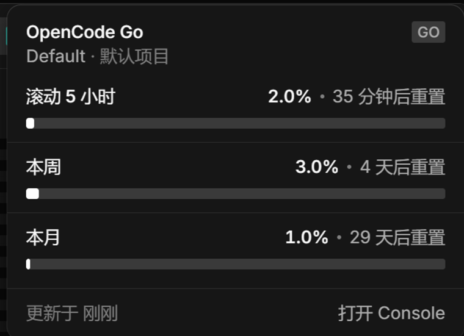

<p align="center">
  <a href="README.md"></a>
  <a href="README.zh-CN.md"></a>
</p>

# opencode-go-quota

An OpenCode Desktop GUI plugin that shows the OpenCode Go allowance in the titlebar. A ring pill sits in the window titlebar (top right):
the OpenCode mark at the centre, and one arc per Go allowance window around it — monthly
in white at the base, weekly in amber, and the rolling 5-hour window in blue on top.
Hover it to open a card with the same numbers as bars; click it to open the Console usage
page.



## Whose quota is it?

The numbers come from `GET /api/experimental/usage/limits`, which answers one question:
*for this location, which Console workspace is signed in, and what is its Go allowance?*

Resolution order:

1. **Location** — the directory of the session you are looking at. The plugin passes
   `location.directory` on every request, so the answer follows the project you switched to.
   You can pin it with the `location` option instead.
2. **Credential** — the server's active credential for the `opencode` integration (the
   Console login). A machine has one active Console account at a time; the server stores it,
   the plugin never touches the secret.
3. **Workspace** — the Console workspace that credential belongs to. The card shows its
   name (`Default` here) and the project directory the answer was resolved from.

So the card is not hardcoded to an account: it describes whatever workspace the current
location resolves to, and it degrades cleanly when that is nothing.

| Server answer | Pill | Card |
|---|---|---|
| workspace + Go meters | ring + `OpenCode Go · 21%` | three bars |
| workspace, no Go plan | dimmed ring + `OpenCode Go · 未订阅` | Console budget bar, or a "no plan" note |
| `data: null` (no Console login) | dimmed ring + `OpenCode Go · 未登录` | 未登录 |
| request failed | dimmed ring + `OpenCode Go · 获取失败` | 获取失败 |
| limit reached | red mark + `OpenCode Go · 已达上限` | 已达上限 |

## The card

```
OpenCode Go                              GO
Default · zcodeplayground
滚动 5 小时          3.0% · 4 小时后重置
▬▬▬▬▬▬▬▬▬▬▬▬▬▬▬▬▬▬▬▬▬▬▬▬▬▬▬▬▬▬▬▬▬▬▬
本周                 1.0% · 5 天后重置
▬▬▬▬▬▬▬▬▬▬▬▬▬▬▬▬▬▬▬▬▬▬▬▬▬▬▬▬▬▬▬▬▬▬▬
本月                 0% · 30 天后重置
▬▬▬▬▬▬▬▬▬▬▬▬▬▬▬▬▬▬▬▬▬▬▬▬▬▬▬▬▬▬▬▬▬▬▬
更新于 刚刚                            打开 Console
```

- The card follows the app's v2 `usage-dialog` style: 13px/440 type, 0.5px dividers,
  native `background-bg-base` / `border-border-base` / `elevation-floating` tokens,
  and 8px square bars filled with `background-bg-inverse` (white in dark theme).
  A reached limit turns the value and bar red.
- The card uses the app's CSS variables, so it follows the current light or dark theme.
- Percentages below 1% keep two decimals (`0.03%`), so light usage is visible.
- Refreshes every `refreshSeconds`, when the active session changes, and when the window
  regains focus (at most once every 15 s).

## The titlebar icon

`TitlebarItem.icon` only accepts one of the app's built-in icon names, so the ring is a
small inline SVG that the plugin injects into its own pill:

- 24 × 24 px, with the OpenCode mark in the centre;
- a neutral 3.4 px track, then three arcs on the same centreline, clockwise from 12 o'clock;
- monthly in white at 3.4 px (base), weekly in amber at 2.2 px, rolling 5 hours in blue at
  1.2 px (top);
- each arc spans its own percentage, so the exposed edge of a wider lower layer shows how
  the shorter window compares with the longer one;
- loading hides the ring for the built-in spinner, missing data dims it, and a limit turns
  the mark red.

The injection only targets horizontal titlebars. On a vertical titlebar the standard icon
stays, so the plugin keeps working on layouts this patch does not cover.

## Options

All optional, set on the plugin entry:

```jsonc
{
  "plugins": [
    {
      "package": "C:\\tools\\opencode-go-quota",
      "options": {
        "refreshSeconds": 60,
        "location": "C:\\work\\client-a",
        "openUrl": "https://opencode.ai/console"
      }
    }
  ]
}
```

| Option | Default | Meaning |
|---|---|---|
| `refreshSeconds` | `60` | Poll interval, clamped to 15–3600. |
| `location` | active session directory | Directory used to resolve the Console workspace. Pin it when one machine should always report one account. |
| `openUrl` | Console root | Fallback link when the server returns no `usageURL`. |
| `apiKey` | unset | OpenCode Go API key. If set, API-key mode wins over the Console session. Stored in plain text in `opencode.json`. |

## Data source

Console mode uses `ctx.client.usage.limits({ location: { directory } })` →
`GET /api/experimental/usage/limits`.

API-key mode uses `GET https://opencode.ai/zen/go/v1/usage` with
`Authorization: Bearer <key>`. The request runs in the desktop main process, because the
endpoint's CORS preflight rejects the renderer's `Authorization` header. The API response is
normalized into the same rolling/weekly/monthly meters.

```jsonc
{ "workspace": { "name": "Default", "usageURL": "…" },
  "go": { "rolling": { "percent": 3.0, "limited": false, "resetsAt": 1793160000000 },
          "weekly": { … }, "monthly": { … } },
  "budgets": [] }
```

## Sign-in modes

The plugin ships no credentials. It supports two modes:

- **Console session (default):** it asks the local OpenCode server, which uses the Console
  session the app already holds. Each user needs OpenCode Desktop 2.x, a signed-in Console
  account — **Account** in the app, or `/connect` → **OpenCode Console** in the TUI — and a
  Go or Go Plus subscription.
- **API key:** hover the titlebar ring, click **Use API key** at the bottom of the card, paste
  the key into the card, and press **Sign in**. The command palette also has **OpenCode Go:
  Set OpenCode Go API Key**. The key is stored locally in plain text and sent only to
  `https://opencode.ai/zen/go/v1/usage`. Click **Sign out** in the card, or use **OpenCode Go:
  Forget OpenCode Go API Key**, to return to Console mode.

`usage.limits` returns `data: null` for a location with no Console sign-in, and the card shows
**未登录** with links to the Console and API-key login. Switching Console accounts happens in
OpenCode, not in the card: the card always describes the account currently active for the
location.

## Install

### From the release zip (no Node, no npm)

1. Download the latest zip from [Releases](https://github.com/boingsetta/opencode-go-quota/releases/latest).
2. Extract the archive under `%USERPROFILE%\.config\opencode\plugins\`. The folder name is
   arbitrary (the archive root is `opencode-go-quota`); it must contain `package.json` and
   `dist/gui-experimental.cjs` directly.
3. Start or restart OpenCode Desktop.

Nothing else — package directories under `~/.config/opencode/plugins/` are discovered
automatically, so the config stays untouched.

If the pill does not appear, check **Settings › Extensions › Plugins** for `go-quota`, and
`~/.local/share/opencode/log/opencode.log` for a `loading plugin` line.

### From an arbitrary folder

Extract anywhere permanent and point the global config at the directory:

```jsonc
{
  "plugins": ["C:\\tools\\opencode-go-quota"]
}
```

Relative paths resolve from the config file; a path to a single file is skipped.

### From GitHub

The built bundle is committed under `dist/`, so the repository can be installed directly:

```powershell
opencode plugin add github:boingsetta/opencode-go-quota
```

Or clone it into the plugins directory:

```powershell
git clone https://github.com/boingsetta/opencode-go-quota `
  "$env:USERPROFILE\.config\opencode\plugins\go-quota"
```

Restart OpenCode Desktop. The directory contains `package.json` and
`dist/gui-experimental.cjs`; no build step is needed for installation.

### From source

```powershell
git clone https://github.com/boingsetta/opencode-go-quota
cd opencode-go-quota
npm install
npm run build
```

`npm run build` writes `dist/gui-experimental.cjs`. The desktop app reloads plugins when the
bundle changes, so no restart is needed after a rebuild.

## How the hover works

`TitlebarItem` only renders an icon and a text label, so the card is drawn by the plugin:

- one fixed-position element under `body`, 14 px from the window's right edge;
- `pointermove` finds the pill through its accessible name (`aria-label` starting with
  `OpenCode Go`) and compares rectangles, so window moves, resizes and DPI changes do not
  matter;
- the column from the pill down to the card counts as one hover surface, with a 300 ms
  grace period, so the pointer can cross the gap;
- `pointerleave` and window `blur` close it; a hidden card is `pointer-events: none`.

## Develop

```powershell
npx vite build --watch
```

Each rebuild reloads the GUI in every window. The bundle must stay one CommonJS file, which
the `gui()` Vite preset guarantees.

## Uninstall

Remove the `plugins` entry, or turn the GUI off in **Settings › Extensions › Plugins**.

## Notes and limits

- The GUI plugin API is experimental (`./gui-experimental`); a future OpenCode release may
  need changes.
- The endpoint reports one workspace per location. Multiple Console accounts on one machine
  are switched in OpenCode itself, not from this card — the credential API returns secrets,
  so the plugin deliberately does not read it.
- Requires OpenCode Desktop 2.x with a signed-in Console account for `usage.limits` to return data.

## Links

- Repository: https://github.com/boingsetta/opencode-go-quota
- License: MIT, see [`LICENSE`](LICENSE).
