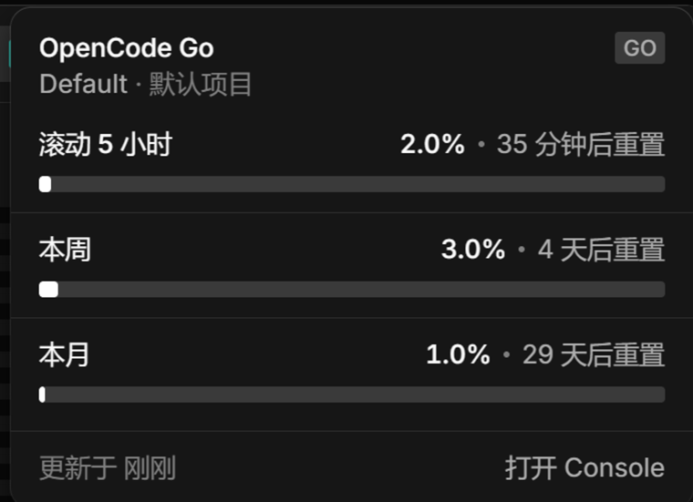

<p align="center">
  <a href="README.md"></a>
  <a href="README.zh-CN.md"></a>
</p>

# opencode-go-quota

一个 OpenCode Desktop GUI 插件，在标题栏显示 OpenCode Go 额度。标题栏右上角有一个环形胶囊：中间是 OpenCode 标志，外圈三段弧分别表示三个额度窗口——本月为白色底弧，本周为琥珀色，滚动 5 小时为蓝色顶层。悬停打开卡片，用进度条显示同样的数字；点击可打开 Console 用量页。



## 额度属于谁？

数字来自 `GET /api/experimental/usage/limits`，它回答一个问题：
*对于当前目录，登录的是哪个 Console 工作区，它的 Go 额度是多少？*

解析顺序：

1. **位置** — 当前会话所在目录。插件每次请求都带 `location.directory`，所以切换到哪个项目，数字就跟随哪个项目。也可以用 `location` 选项固定。
2. **凭据** — 本地 OpenCode 服务中 `opencode` 集成的活动凭据（Console 登录）。一台机器同一时间只有一个活动 Console 账号；凭据由服务端保存，插件不会读取密钥。
3. **工作区** — 该凭据所属的 Console 工作区。卡片显示工作区名称（例如 `Default`）和解析所用的项目目录。

所以卡片不是硬编码到某个账号：它描述当前目录解析到的工作区；解析不到时会干净地降级。

| 服务端返回 | 胶囊 | 卡片 |
|---|---|---|
| 工作区 + Go 额度 | 环形图标 + `OpenCode Go · 21%` | 三条进度条 |
| 工作区，但没有 Go 套餐 | 变暗的环形图标 + `OpenCode Go · 未订阅` | Console 预算条，或“未订阅”提示 |
| `data: null`（没有 Console 登录） | 变暗的环形图标 + `OpenCode Go · 未登录` | 未登录 |
| 请求失败 | 变暗的环形图标 + `OpenCode Go · 获取失败` | 获取失败 |
| 达到上限 | 红色标志 + `OpenCode Go · 已达上限` | 已达上限 |

## 卡片

```
OpenCode Go                              GO
Default · zcodeplayground
滚动 5 小时          3.0% · 4 小时后重置
▬▬▬▬▬▬▬▬▬▬▬▬▬▬▬▬▬▬▬▬▬▬▬▬▬▬▬▬▬▬▬▬▬▬▬
本周                 1.0% · 5 天后重置
▬▬▬▬▬▬▬▬▬▬▬▬▬▬▬▬▬▬▬▬▬▬▬▬▬▬▬▬▬▬▬▬▬▬▬
本月                 0% · 30 天后重置
▬▬▬▬▬▬▬▬▬▬▬▬▬▬▬▬▬▬▬▬▬▬▬▬▬▬▬▬▬▬▬▬▬▬▬
更新于 刚刚                            打开 Console
```

- 卡片遵循应用 v2 `usage-dialog` 风格：13px/440 字体、0.5px 分隔线、原生 `background-bg-base` / `border-border-base` / `elevation-floating` token，以及 8px 方形进度条，填充色为 `background-bg-inverse`（深色主题下为白色）。达到上限时数值和进度条变红。
- 卡片使用应用的 CSS 变量，跟随当前浅色或深色主题。
- 小于 1% 的百分比保留两位小数（例如 `0.03%`），轻微用量也看得见。
- 每 `refreshSeconds` 刷新；切换活动会话、窗口重新获得焦点时也会刷新（最多 15 秒一次）。

## 标题栏图标

`TitlebarItem.icon` 只接受应用内置的图标名，所以环形图标是插件注入到自己胶囊里的一小段内联 SVG：

- 24 × 24 px，中心是 OpenCode 标志；
- 一条 3.4 px 的中性底轨，然后同一圆心上的三段弧，从 12 点方向顺时针排列；
- 本月为白色 3.4 px（底层），本周为琥珀色 2.2 px，滚动 5 小时为蓝色 1.2 px（顶层）；
- 每段弧按自己的百分比绘制，所以较宽的下层边缘露出的长度，可以直观看出较短窗口与较长窗口的比例；
- 加载时隐藏环形图标，显示内置 spinner；没有数据时变暗；达到上限时标志变红。

注入只针对水平标题栏。垂直标题栏下会保留标准图标，所以这个补丁没有覆盖的布局里插件仍然可用。

## 选项

全部可选，写在插件条目上：

```jsonc
{
  "plugins": [
    {
      "package": "C:\\tools\\opencode-go-quota",
      "options": {
        "refreshSeconds": 60,
        "location": "C:\\work\\client-a",
        "openUrl": "https://opencode.ai/console"
      }
    }
  ]
}
```

| 选项 | 默认值 | 含义 |
|---|---|---|
| `refreshSeconds` | `60` | 轮询间隔，限制在 15–3600 秒。 |
| `location` | 当前会话目录 | 用于解析 Console 工作区的目录。固定后可让一台机器始终报告同一个账号。 |
| `openUrl` | Console 根地址 | 服务端没有返回 `usageURL` 时的回退链接。 |
| `apiKey` | 未设置 | OpenCode Go API Key。设置后 API Key 模式优先于 Console 会话。会以明文保存在 `opencode.json` 中。 |

## 数据来源

Console 模式使用 `ctx.client.usage.limits({ location: { directory } })` →
`GET /api/experimental/usage/limits`。

API Key 模式使用 `GET https://opencode.ai/zen/go/v1/usage`，并带上
`Authorization: Bearer <key>`。请求在桌面主进程中执行，因为该接口的 CORS 预检会拒绝
渲染进程的 `Authorization` 头。API 响应会被归一化成同样的滚动 5 小时/本周/本月三个窗口。

```jsonc
{ "workspace": { "name": "Default", "usageURL": "…" },
  "go": { "rolling": { "percent": 3.0, "limited": false, "resetsAt": 1793160000000 },
          "weekly": { … }, "monthly": { … } },
  "budgets": [] }
```

## 登录方式

插件不自带凭据，支持两种模式：

- **Console 会话（默认）：** 向本地 OpenCode 服务查询，使用应用已有的 Console 登录。每个用户需要 OpenCode Desktop 2.x、已登录的 Console 账号（应用里的 **Account**，或 TUI 里的 `/connect` → **OpenCode Console**），以及 Go 或 Go Plus 订阅。
- **API Key：** 悬停标题栏环形图标，点击卡片底部的 **使用 API Key**，把 Key 粘贴到卡片里，点击 **登录**。命令面板里也有 **OpenCode Go: 设置 OpenCode Go API Key**。Key 会以明文保存在本地，只发送到 `https://opencode.ai/zen/go/v1/usage`。点击卡片底部的 **退出 API Key**，或运行 **OpenCode Go: 清除 OpenCode Go API Key**，即可回到 Console 模式。

没有 Console 登录时，`usage.limits` 会返回 `data: null`，卡片显示 **未登录**，并提供 Console 和 API Key 登录入口。切换 Console 账号在 OpenCode 内完成，不在卡片里：卡片始终描述当前目录对应的工作区。

## 安装

### 从 Release zip 安装（不需要 Node/npm）

1. 从 [Releases](https://github.com/boingsetta/opencode-go-quota/releases/latest) 下载最新 zip。
2. 解压到 `%USERPROFILE%\.config\opencode\plugins\`。文件夹名可以任意（压缩包根目录是 `opencode-go-quota`）；里面必须直接包含 `package.json` 和 `dist/gui-experimental.cjs`。
3. 启动或重启 OpenCode Desktop。

不需要其他操作——`~/.config/opencode/plugins/` 下的包目录会被自动发现，配置文件不用改。

如果胶囊没有出现，检查 **Settings › Extensions › Plugins** 里是否有 `go-quota`，并查看 `~/.local/share/opencode/log/opencode.log` 里是否有 `loading plugin` 记录。

### 从任意文件夹安装

解压到任意永久目录，然后在全局配置里指向该目录：

```jsonc
{
  "plugins": ["C:\\tools\\opencode-go-quota"]
}
```

相对路径从配置文件所在目录解析；指向单个文件的路径会被跳过。

### 从 GitHub 安装

构建产物 `dist/` 已经提交，所以可以直接从仓库安装：

```powershell
opencode plugin add github:boingsetta/opencode-go-quota
```

或者克隆到插件目录：

```powershell
git clone https://github.com/boingsetta/opencode-go-quota `
  "$env:USERPROFILE\.config\opencode\plugins\go-quota"
```

重启 OpenCode Desktop。目录里包含 `package.json` 和 `dist/gui-experimental.cjs`，安装不需要构建。

### 从源码构建

```powershell
git clone https://github.com/boingsetta/opencode-go-quota
cd opencode-go-quota
npm install
npm run build
```

`npm run build` 会生成 `dist/gui-experimental.cjs`。桌面应用会在 bundle 变化时重新加载插件，重建后不需要重启。

## 悬停如何工作

`TitlebarItem` 只渲染图标和文字标签，所以卡片是插件自己绘制的：

- 一个固定定位的元素挂在 `body` 下，距离窗口右边缘 14 px；
- `pointermove` 通过无障碍名称（以 `OpenCode Go` 开头的 `aria-label`）找到胶囊并比较矩形，所以窗口移动、缩放和 DPI 变化都不受影响；
- 从胶囊到卡片的整列算作一个悬停区域，并带 300 ms 宽限期，指针可以跨过中间空隙；
- `pointerleave` 和窗口 `blur` 会关闭卡片；隐藏的卡片是 `pointer-events: none`。

## 开发

```powershell
npx vite build --watch
```

每次重建都会重新加载所有窗口里的 GUI。bundle 必须保持单个 CommonJS 文件，`gui()` Vite 预设会保证这一点。

## 卸载

移除 `plugins` 条目，或在 **Settings › Extensions › Plugins** 里关闭这个 GUI 插件。

## 注意事项和限制

- GUI 插件 API 是实验性的（`./gui-experimental`）；未来的 OpenCode 版本可能需要适配。
- 接口按位置报告一个工作区。同一台机器上的多个 Console 账号是在 OpenCode 里切换的，不在卡片里——凭据 API 会返回密钥，所以插件刻意不去读取它。
- 需要 OpenCode Desktop 2.x，并且已登录 Console 账号，`usage.limits` 才会返回数据。

## 链接

- 仓库：https://github.com/boingsetta/opencode-go-quota
- 许可证：MIT，见 [`LICENSE`](LICENSE)。
